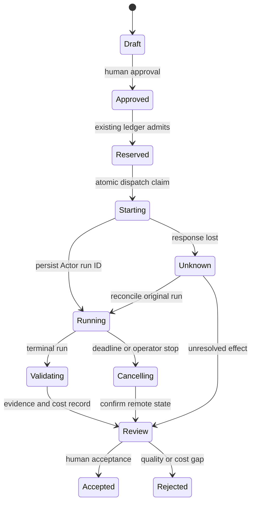

# Apify research starter kit: proposed product specification

State: specification proposal, unpriced and unavailable for purchase.
Prepared: 2026-11-13. Version: 0.1. Owning editorial issue: #1149.
Partner eligibility: #1175. Runtime integration remains with the existing Starlight lane.

## Buyer, job and promise

Buyer hypothesis: a technical founder or AI architect already operating an agent
client or job runner who needs a recurring, defensible vendor-page comparison.
The job is to produce a cited change brief that another person can verify without
repeating the entire crawl. Customer demand and willingness to pay are unmeasured.
No customer evidence is implied by persona fit.

Proposed promise: configure a bounded public-page research mission and export its
source-linked evidence, normalized differences, complete attempt costs and review
decision. Live execution support is conditional on the buyer's own provider access.
No promised setup duration, collection success rate, savings or income.

The strongest alternative is a manual page check plus a spreadsheet. A direct fetch
and deterministic parser can also be cheaper for a small fixed source. Apify earns
a place only when its extraction behavior reduces accepted-output effort enough to
cover provider cost and maintenance. A team requiring private authenticated data,
unrestricted crawling or a hosted service SLA is outside this edition's scope.

## Product boundary and placement

This spec adds no admitted product/SKU and does not allocate another revenue-release
slot. FrankX owns the article and educational packet in this repository. Proposed
portable adapter implementation must reuse the existing Starlight integration owner;
no new repository or second MCP server is authorized. Resolve a canonical product
record, license and source repository through the reviewed Registry before sale.
Primary production capability: Publishing, with bounded software verification.

Free proof candidate: article, request planner, mission fixture and acceptance rubric.
Paid edition candidate: reviewed runtime adapter, migration/configuration guide,
validated failure fixtures and an operator runbook. Sell the ability to inspect and
adapt a complete method; do not repackage a vendor referral as the product.

Price state is **unpriced**. A possible owner-reviewed experiment is EUR 49 for a
single-operator implementation edition after a real buyer completes activation.
This is a recommendation, not a public price or an instruction to create checkout.
No scarcity, crossed-out price, earnings projection or lifetime-support promise.

## Inputs, outputs and delivered files

| Input | Constraint |
| --- | --- |
| Mission | Stable mission/dispatch ID, named human owner and deadline |
| Sources | Exact approved targets, purpose, access basis, final-URL rules and retention rights |
| Actor | Inspected identity, numbered build, schema checksum, permissions and dated rate card |
| Authority | Separate approval, entitlement/credit observation and per-mission/day budget reservation |
| Expected data | Product/plan identity, price, currency, billing period, qualification text and source locator |
| Processing | Maximum targets, bytes, pages, attempts, inference tokens and concurrency |

Deliver a versioned archive with README, configuration template, no-secret demo,
MCP/API request examples, provider-neutral evidence schema, fixtures/tests, expected
synthetic output, cost worksheet, rights notes, changelog and support boundary.
An execution edition additionally needs a supported-runtime matrix and reviewed
adapter. A model prompt alone is not the paid deliverable.

The current draft includes only the planner, its tests, a synthetic mission,
evaluation template, article and this specification. It does not contain the
production adapter, deployed storage, licensed commercial archive or checkout.

The exported research package contains `mission.json`, `sources.jsonl`, normalized
records, differences, `claims.json`, `costs.json`, `review.md` and a checksum manifest.
Only retained content with a valid storage/reuse basis enters the package. All fields
are inspectable without a proprietary dashboard. Keep raw evidence, normalized
data and generated interpretation distinct.

## State, recovery and permission contract

Proposed state machine:

Do not collapse process completion, evidence acceptance and publication into a
single success field. Rejected and cancelled attempts remain in the cost ledger.

Admission reserves the mission ceiling atomically in the existing budget authority.
The inspected agent plane's Supabase ledger is that interface; D1 is an index.
Runtime integration must reconcile this with any separate mission-control admission
before release. Never maintain two independently spendable balances.

Persist dispatch ownership before side effects, then persist the Actor run ID as
soon as it arrives. A transport error after a start POST produces `Unknown`, not
permission to start again. Application idempotency keys do not imply Apify honors
the same header. Reconcile ambiguous starts before replay. The provider's run timeout
and explicit abort are separate from the local HTTP request timeout.

Retry safe reads only for bounded transient failures, with capped exponential
backoff and jitter. Do not retry permission, plan, schema or invalid-budget failures.
Retain all attempts and billable nested work; the aggregate mission limit includes
child runs, storage and inference. A local permission/URL check cannot constrain a
remote Actor's entire network activity. Select and review an appropriate Actor.

## Acceptance rubric

The numerical values below are proposed release thresholds, not achieved results.
Evaluate both interfaces against identical input/build/configuration. A human
reviewer binds acceptance to the exact artifact and source snapshot.

| Gate | Proposed pass condition |
| --- | --- |
| Authority | No execution without scoped approval, entitlement observation and reservation |
| Provenance | Every retained record has source/final URL, retrieval time, checksum, Actor/build/input hash and live or synthetic designation |
| Fidelity | Every expected fixture field matches; annual commitment, currency and tax qualification survive normalization |
| Truth | Zero unsupported claims in the change note; missing values stay explicit |
| Recovery | Duplicate delivery, lost start response, timeout and cancellation cannot silently create a second run |
| Costs | No unknown charge recorded as zero; all attempts reconcile before budget release |
| Portability | A fresh environment can inspect/export the result without access to the original dashboard |
| User value | One external technical user creates and verifies their own authorized brief, then repeats the job without maker intervention |

Record schema fidelity as correct required fields divided by expected required
fields; source coverage as supported factual claims divided by factual claims;
and accepted yield as accepted records divided by all returned records. Empty
denominators remain null. Human review must adjudicate factual support. No aggregate
score can compensate for missing permission, provenance, cost or rights evidence.

Required fixtures: empty dataset; challenge/consent page; malformed row; missing
currency; annual/monthly ambiguity; duplicate/canonical redirects; stale page;
prompt injection; unauthorized final URL; denied entitlement; run failure;
partial output; request timeout with uncertain start; remote abort pending;
duplicate queue delivery; cost-field lag; unknown or over-cap charge.

Current local tests cover request planning and arithmetic boundaries only. They
do not claim to cover this runtime acceptance suite.

## Cost model and commercial viability

Maintain both economic usage and cash invoice records. Economic cost includes all
Actor/platform attempts, paid events, storage/exports, inference, orchestration,
review and support. Apply prepaid balances once when estimating incremental cash.
Vendor test credits reduce cash outlay but remain a disclosed subsidy, not proof
of lower underlying cost.

`contribution = collected price - refunds - payment/platform fees - attributable acquisition - delivery - support - provider usage`.

No real price, fee, refund, support-time or accepted-outcome measurement exists for
this kit, so contribution margin and cost per accepted artifact remain unknown.
Use the evaluated provider breakdown to avoid counting event-covered compute twice.

Stop expansion when the manual alternative is better for the target user, entitlement
remains blocked, the adapter duplicates existing runtime work, or no external user
accepts a useful brief in the first bounded validation cycle. Retain the free
educational artifact. This does not authorize retiring any existing product.

## Delivery, rights and maintenance gates

Before any sale: owner-approved product/source placement, price, merchant, license,
territories, tax/refund terms, support duration and dependency policy; clean-machine
install; real authorized mission; independent exact-revision review; accessible
instructions; checkout-to-entitlement-to-download test; refund/revocation and export
test. A working archive alone does not prove fulfillment.

Proposed maintenance: recheck API/MCP schemas and Actor prices before each release;
monthly compatibility review after launch; publish correction/version notes for
breaking changes. Propose a defined support term rather than lifetime updates.
License scope remains unresolved; the website's existing reserved-rights license
applies to this draft. Do not redistribute third-party page dumps or partner marks
without rights evidence.

## Measurement and next external gate

Activation: a user configures an authorized source, produces a fully traceable
brief, confirms its facts and exports it. Log acceptance separately from completion.
After approved publication, measure article-to-example inspection, example-to-
accepted-brief activation, disclosed referral clicks and qualified conversions.
Reuse existing privacy-aware analytics; no raw URLs with personal query parameters,
page text, tokens or tenant IDs in marketing events. Current baseline is unknown.

Next external gate: integration owner supplies a real authorized run receipt,
retained evidence, reconciled costs and QA acceptance. Frank separately approves
publication and, later, any commercial product release.
