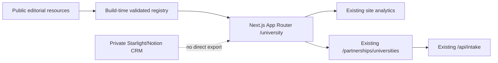

# University Commons · PRD + ADR · v0.1
Owner: FrankX. Delivery authority: [agentic-ops#263](https://github.com/frankxai/agentic-ops/issues/263). Status: review candidate; no deployment approval.

## Decision and source audit
Keep Next.js App Router, Vercel, existing /api/intake, existing analytics, existing content/search generators, and Starlight's private institutional intake. Existing /partnerships/universities remains the institutional invitation. Existing /workshops/for-educators remains educator content. Existing content/partnerships/university-collaboration.ts supplies research tracks, briefs and readings. Do not copy private Notion records or imply UvA affiliation. See Notion University & Research Partnerships, Strategy/offers/student experience, Digital Product Foundry and REC Impact proposal. No Astro migration: no demonstrated performance/cost upside exceeding migration and regression cost.

## Product requirement
A free, accessible, indexable discovery experience for five audiences: Students (learn/build), Professors (teach/adapt), Researchers (reproduce/contribute), Founders (validate/build), Community (participate/share). One resource can serve several audiences; no duplicated catalogs. Primary outcome: user finds one actionable resource in <=3 interactions and can continue without creating an account. Secondary outcome: qualified collaboration inquiry via the existing intake.

## Route map
- /university: public entry, five audience cards, curated resources, methodology and independent-status disclosure
- /university/students, /professors, /researchers, /founders, /community: planned filtered audience landing pages (v0.2)
- /university/resources: planned searchable index (v0.2)
- /university/resources/[slug]: planned editorial detail page for locally owned content only
- /partnerships/universities: canonical existing collaboration form; do not replace
- /workshops/for-educators: existing instructor guide
- /partnerships/proposal/uva-rec-impact: existing unlisted context; noindex remains

Navigation: University Commons as an optional entry in existing education/learn context after UX review; Commons local nav = five audiences, resources, collaborate. No global navigation change in first PR.

## Content contract (TypeScript discriminated editorial registry)
Resource { id: stable slug; title: string; summary: string; href: absolute https URL or approved same-origin path; audiences: Audience[]; kind: 'guide'|'tool'|'research'|'workshop'|'challenge'|'community'; topic: 'ai-systems'|'evaluation'|'research'|'entrepreneurship'|'education'|'impact'; level: 'beginner'|'intermediate'|'advanced'|'all'; access: 'free'|'freemium'|'paid'; publisher: string; language: BCP47 tag; provenance: 'first-party'|'third-party'; reviewedAt: YYYY-MM-DD; rights: 'link-only'|'owned'|'licensed'; status: 'verified'|'review-needed'|'internal'; nextAction: string; external?: boolean }. Publication only status=verified, rights=link-only/owned/licensed, and reviewedAt present. A first-party workshop is not an accredited course.

## Resource taxonomy and launch acceptance
25 useful assets target: 5 starter guides, 5 executable tools/templates, 5 readings/research methods, 5 challenges/workshops, 5 community/contribution pathways. Editorial verification requires reachable destination, actual utility, rights, audience, cost, provenance and dated review. Do not fabricate 25 verified entries. Initial PR reuses existing three research readings and three challenge briefs; expansion to 25 is a release gate rather than placeholder cards.

## Component architecture
UniversityLanding (server), AudienceCard, ResourceCard, ResourceFilters (progressive enhancement), ResourceAttribution, EditorialStatus, CollaborationCTA. Reuse site typography/tokens, links and existing intake; do not instantiate a second analytics client or identity system. Build-time registry validation; no DB for curated v0.1.

## Data and privacy boundaries
Public Git content -> static server-rendered pages. Private Notion institutional/CRM records -> never imported. Existing intake endpoint -> existing consent, rate limit, spam and delivery rules. No PII in analytics, search query telemetry or URL campaign parameters. No user accounts, student submissions, tracking pixels or research participant data in v0.1. Academic ethics approval and participant consent are separate from newsletter/marketing consent. No university logos or institutional endorsements.

## Search and i18n
v0.1: browser find + audience links, server-rendered indexable cards. v0.2: reuse existing generated search index, deterministic title/summary/topic scoring, keyboard-operable filter and no personal query logging. English default; use locale-aware content metadata and BCP47, do not pretend machine-translated pages have editorial approval. Add nl/de only after human review, localized canonical/hreflang and parity tests.

## Analytics and conversion
Use existing consent-aware analytics: university_view, university_audience_selected, university_resource_opened, university_collaboration_clicked; properties limited to audience, resource ID, resource kind and route. No email/name/search text. North star: verified resource opens per engaged Commons visit. Guardrail: broken-link rate, inquiry completion, a11y regressions. Conversion path: free resource -> bounded practical activity -> existing university collaboration inquiry; sponsored/paid offers only where clearly disclosed, never gated behind academic endorsement.

## Accessibility and performance
WCAG 2.2 AA target: semantic landmarks, unique H1, visible focus, skip link from site shell, no hover-only action, keyboard navigation, contrast >=4.5:1 for body text, 200% zoom and 320px viewport reflow, reduced motion, accessible error messages. Static-first rendering, no new JS for initial discovery; preserve existing site performance budgets.

## Architecture

## ADRs
ADR-001 Accepted: extend Next.js; Astro rejected absent quantified migration case.
ADR-002 Accepted: Git-curated resources as source of truth for public v0.1; no database.
ADR-003 Accepted: reuse existing /api/intake and analytics; no new data processor.
ADR-004 Accepted: separate public Commons from private research/institutional records.
ADR-005 Proposed: v0.2 generated search index reuse, only after measured need.

## Issue breakdown under #263 (no duplicate tracker)
A. Source/rights audit and 25 verified assets (release blocking).
B. Five audience journeys and local navigation (release blocking).
C. Reuse existing search and analytics with consent review (post-v0.1).
D. WCAG audit, narrow/mobile and keyboard tests (release blocking).
E. Independent institutional/editorial review (release blocking).
F. Preview CI and exact-head acceptance; merge/deploy only with founder approval.

## Test plan
- Static contract: route, title, five audiences, valid internal/external links, no university affiliation claim, no private data.
- Content: unique IDs, 25 approved and reachable resources before broad release, rights/review dates, no placeholder claims.
- E2E: each audience -> resource -> collaboration; keyboard and screen-reader smoke; 320px/200% zoom.
- Regression: /partnerships/universities and /api/intake validation, consent and spam protections unchanged.
- CI: pnpm type-check, lint, scoped tests, build, Vercel preview review; record evidence in PR.
- Release gate: exact-head CI, independent review, founder approval. No production deployment from this PR.
