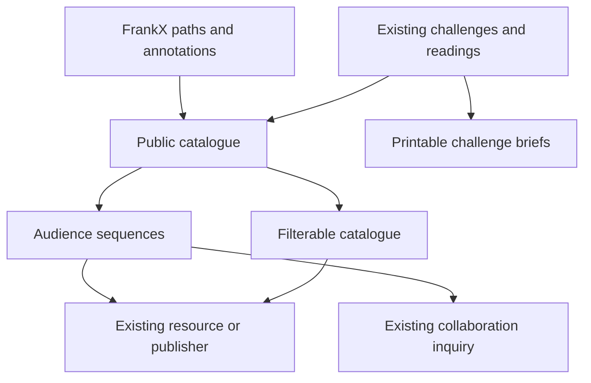
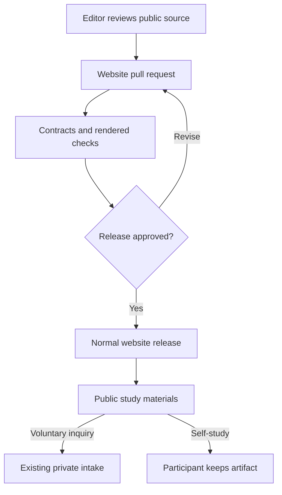
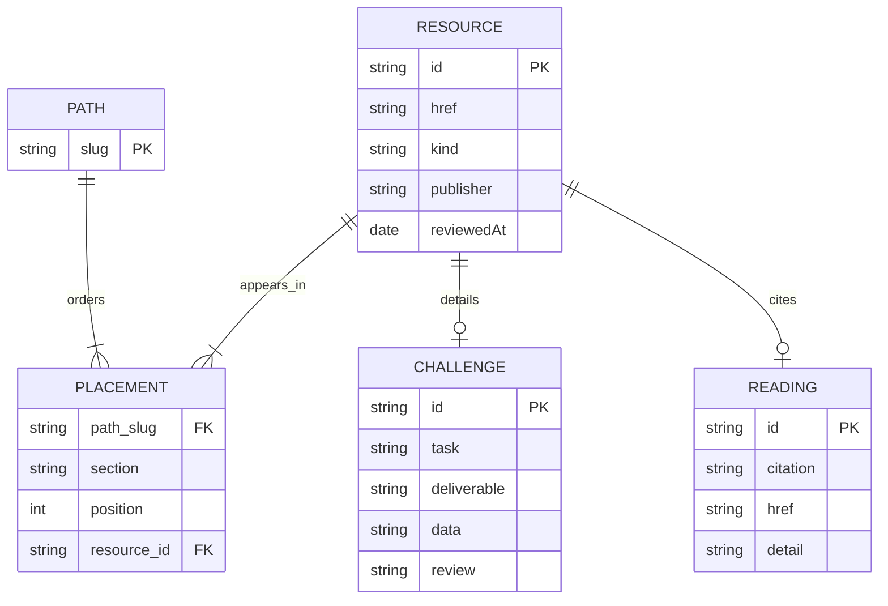

# FrankX University Commons

**Release decision · 18 November 2026.** Add ten public pages to the existing FrankX application. A visitor should be able to choose their role and open a relevant working resource in two selections from the Commons home. The institution-facing invitation remains the place to discuss facilitated delivery. The release candidate belongs to website PR #1274 under the existing university partnerships mission, agentic-ops#263. Frank owns editorial admission and production approval.

## What already exists

| Source examined | Existing capability or constraint | Product decision |
| --- | --- | --- |
| University & Research Partnerships | Private relationship desk, institution intake, research contribution ledger, existing CRM and mission ownership. Starlight Atlas is the designated route for reviewed public institutional facts. | Link to public institutional sources. Keep relationship records and pipeline outside the website. |
| Strategy, offers & student experience | A source-linked artifact, bounded evaluation, peer review and learner ownership are the core learning outcome. The lecturer, academic supervisor and budget owner have different responsibilities. | Give learners a free path with an offline option. Give hosts a separate inquiry after the materials. |
| Digital Product Foundry, canonical home | The Field Guide and Creator Launch OS are admitted product candidates. Catalogue inclusion, editorial approval and demonstrated paid fulfilment are different decisions. | Point to published sources. Every commercial edition must use its existing product owner, rights and delivery contract. |
| REC Impact contribution proposal, 17 November | The proposed 75-minute AI & Purpose and 90-minute Build Your AI Team sessions have participant-owned outputs. Programme terms and hosting require agreement. | Offer related self-study materials. Official university programmes link to their own sites. Scheduling, branding or enrolment needs an agreed host. |
| Ops #263 and website #1266 | The 17 November receipt supersedes the older “website pending” status. Public collaboration invitation, three challenges, readings, intake and unlisted discussion already exist. | Retain the distinction between public learning, institutional inquiry and unlisted meeting context. Reuse the exact briefs and reading records. |
| Website #1274 at 211521d | Draft landing linked five labels to sections of one page and deferred the catalogue and verification. | Extend the same PR to five addressable sequences, a searchable catalogue and three printable briefs. |
| Website main at 9cb1a0c | Package and lockfile declare Next 16.4.5 and React 19.3.x. App Router, Vercel, TypeScript, CSS modules/Tailwind, metadata helper, site search, route enumerator, sitemap, site privacy wrapper and contact intake all exist. | Use the installed versions and deployment path. The older stack summary in AGENTS.md names earlier versions. |

The source materials are operating documents. Only reviewed public descriptions enter the website bundle. The existing public [university invitation](https://www.frankx.ai/partnerships/universities) and [previous website release](https://github.com/frankxai/frankx.ai-vercel-website/pull/1266) provide the public context.

## Product requirements and feature map

| Audience | First job | Working sequence | Output to inspect | Optional handoff |
| --- | --- | --- | --- | --- |
| Students | Build a source-grounded assistant | Evidence challenge → JSON blueprint → offline failure lab → rubric | A bounded workflow with a failure example a peer can explain | Supervised challenge |
| Professors | Adapt one lab for an existing course | Facilitator contract → workbook → scoring rubric → adaptation guide | Run sheet, learning objective and independent scoring exercise | Guest session or facilitated lab |
| Researchers | Design a reproducible comparison | Observed productivity study → follow-up on selection → versioned record → quote experiment | Preregistered baseline, limitations, review cost and failure measure | Reproduction or scoped translation |
| Founders | Test one risky product assumption | Product brief → quote protocol → weekly stack audit → risk register | Prototype acceptance test, review burden and stop decision | Bounded pilot with a responsible owner |
| Community | Decide whether a problem warrants a prototype | Public-interest brief → accessibility checks → member-outcome worksheet → local networks | Stakeholder brief, accessible trial and invitation through the host | Co-design or host a challenge |

| Feature | Acceptance for this PR | Owning implementation |
| --- | --- | --- |
| Discovery | Every role has a real URL and a distinct first task. Website search and sitemap derive from the same public route enumeration. | App Router, route enumerator and generated route index |
| Curation | 20–30 distinct assets, each with an action, source, format, access and language. Every asset occurs on at least one path. | Public catalogue projection plus existing briefs and readings |
| Retrieval | Search and format intersect. Clearing both restores the complete list. Without JS all resources remain in the HTML. | Catalogue page and small local filter |
| Study | A brief can be opened directly, printed, discussed offline and used without an account. Existing downloads retain their original delivery route. | Brief pages, existing workbook, file and book routes |
| Conversion | Each path describes a relevant next conversation. Visitors can use every starting asset before deciding to make contact. | Existing collaboration intake |
| Operations | Source corrections arrive through a web PR. Removing a bad link requires one catalogue edit plus any affected path references. | Existing release workflow, #263 and FrankX editor |

**Acceptance with people.** Ask one person per role to start at the entry page, choose useful material unaided and explain what they would do with it. Record seconds, wrong turns, the artifact they picked and reasons for abandonment with permission. Target 4/5 finding a relevant asset in 90 seconds, all five accessing a free option, and zero forced sign-ups. These are pilot criteria. Learning gain, independent replication and demand require separate evidence.

## Routes and navigation

| URL | Purpose and indexing |
| --- | --- |
| `/university` | Indexable home. Primary action jumps to five paths. Secondary action opens the catalogue. One real book chapter provides an alternative entry. |
| `/university/students`, `/university/professors`, `/university/researchers`, `/university/founders`, `/university/community` | Five statically generated pages, each with its own title, canonical URL, outcome, ordered working sequence, additional materials and contextual inquiry. |
| `/university/resources` | Indexable catalogue. Filtering has no URL parameters, saved state or additional canonical pages. |
| `/university/challenges/product`, `/university/challenges/evidence`, `/university/challenges/impact` | Standalone briefs from the collaboration content owner. Detail contains task, deliverable, permitted data and review question. Other resources resolve directly to their canonical destination. |
| `/partnerships/universities` and `#join` | Existing public invitation and inquiry. Invitation links back to the Commons. The role selection on the existing form is confirmed by the visitor. |
| `/workshops/for-educators`, `/courses/…`, `/guides/…`, `/books/…`, downloads | Existing destinations retain navigation, access and update ownership. |
| `/search`, `/sitemap.xml` | Existing discovery surfaces receive the ten public routes. |
| `/partnerships/proposal/uva-rec-impact` | Existing unlisted, noindex discussion. No Commons navigation, catalogue entry or index projection. Unlisted URLs are accessible to anyone with the URL. Confidential information belongs in access-controlled systems. |

Use the site shell, skip link and existing search. The collaboration invitation provides contextual entry without changing global navigation. Path pages return to the Commons or catalogue. Briefs return to the catalogue and relevant paths. Unknown audience and challenge slugs return 404. An institution-specific branded alias would require a distinct audience need and naming approval.

## ADR · Workload placement and migration economics

**Adopt the existing Next.js and Vercel deployment.** The resource set is finite, read-heavy and public. It needs HTML, navigation, an in-memory filter and outbound links. Source content, metadata, search discovery, tested intake and release ownership already live here. Marginal platform additions are zero services, zero database migrations and zero third-party runtime packages. Existing hosting still incurs its normal build and serving usage.

An Astro evaluation is deferred. An additional renderer would need to demonstrate savings against these static routes while accounting for parity work across discovery, accessibility, privacy instrumentation, preview review and rollback. Reopen only for a documented production constraint. Compare the same five journeys and compute payback as migration and verification hours × loaded hourly cost divided by measured monthly savings after dual-stack maintenance. No measured saving or migration business case is available.

**Keep editorial state in Git.** Files map directly to release review and atomic rollback. A per-visitor database, hosted search index, login, model call or institution directory adds cost and new data handling without improving the two-selection path. Revisit persistence only for an approved job requiring shared mutable state. Reuse the existing Starlight transactional authority for an approved future purchase or entitlement.

**Preserve source ownership.** FrankX owns paths and public annotations. Research Intelligence OS, Starlight Agent Skills and Agentic Income own the pinned methods, pack and proposed experiment. The public app never calls those services to render. Future institution matching consumes a reviewed Starlight Atlas public projection with explicit source and freshness fields. A filtered Notion view is insufficient for publication.

## Components and data flow

| Component | Inputs and responsibility |
| --- | --- |
| Commons layout + page | Server-rendered site landmark, responsive type and scoped print styles. The featured image comes from the existing book cover. |
| Audience and challenge pages | Resolve allowlisted slugs through static params, use the shared SEO helper and render native links. |
| ResourceList | Renders ordered study steps or catalogue rows from the same records. Presents source, format, task, language and access before opening a link. |
| CatalogSearch | Client-only search state over pre-rendered resources. Multi-token AND matching across title, task, kind, publisher and language in editorial order. No request or storage. |
| CommonsLink | A native anchor remains functional before hydration. Only resource or inquiry activation can emit a bounded event through the existing privacy wrapper. |
| Existing CollaborationExperience and CollaborationIntake | Own presentation, role selection, validation, contact consent, submission, fallback and acknowledgements. |

## Content schema and contracts

Logical schema. Each release snapshot is a transaction represented by one Git tree. The projections have no independent writable copy.

| Record | Required fields and invariants |
| --- | --- |
| Path | Stable unique `slug`, role `title`, `headline`, `outcome`, `invitation`. `sequence[]` and `also[]` are ordered resource foreign keys. A path cannot repeat an ID. At least one free route per sequence. |
| Resource | Unique slug `id`, unique destination `href`, `title`, practical `task`, `publisher`, `kind`, `language`, `access`, dated `reviewedAt`. Admission to the public file is the publication decision. Private drafts stay outside the file. |
| Taxonomy | Role comes from placement. Format includes brief/challenge, lab, workshop, protocol, research reading, workbook, template, skill pack, book chapter, guide, programme and directory. Access describes reading or file access separately from optional paid tools and publisher restrictions. Language describes the destination. |
| Sources and rights | Same-origin files and routes remain under their source owners. External entries grant a link and a FrankX annotation only. Pinned GitHub links identify an exact version. A readable resource grants no right to relicense, mirror, install or redistribute it. Third-party full text, student work and partner marks are outside the registry. |
| Source adaptation | Three brief IDs resolve to the shared JSON in `content/partnerships/`. The three existing research readings carry stable IDs. The other 19 records live in `content/university/resources.json`. Paths are defined once in `paths.json`. |
| Update/retire | Editor opens destination anonymously, checks title, file or task, publisher, access, language and rights, then updates the review date. Recheck quarterly and before teaching or promotion. Replacements with a different purpose receive a new ID. Remove retired items from all placements in the same PR. Preserve published URLs through the site's existing redirect policy when a replacement exists. |

Search remains usable when cookies and JS are disabled through the complete HTML list and browser Find. The existing site search reads the generated route index plus its reading archive. Local filtering indexes public catalogue fields only. A crawler over the content tree would publish a different corpus and has no role in this feature.

## Conversion, measurement and privacy

Treat resource use as the primary conversion. A reader can leave with a printable brief, test run or peer-review packet. For institutional interest, route a professor to a guest lab, a researcher to a reproduction scope, a founder to a pilot and an organiser to hosting. The existing form distinguishes student, academic, technology and founder/impact inquiries. Keep academic supervision, participant consent, budget authority and procurement distinct. A proposed session becomes bookable after the host, timing, responsibilities and access are agreed.

Paid facilitator editions, cohort licences and research sprints belong to the existing commercial process. Confirm scope and authorised buyer, agree price and terms privately, then record delivery and collected revenue in the existing system. Peer review, grades, attribution and student participation are independent of purchases. A future paid pack needs verified rights, checkout, entitlement, fulfilment, support and refund evidence before a catalogue listing.

| Signal | Data contract and interpretation |
| --- | --- |
| Entry or path view | Existing Vercel pageview for canonical path. The route represents a chosen task, not an inferred occupation. |
| Resource activation | `commons_resource_open { item_id: resource.id }`. Count link activations, including repeat opens. A click establishes neither file execution nor learning. |
| Inquiry intent | `commons_inquiry_open { item_id: path.slug }` on contextual path CTA. The role is confirmed again on the form. The generic invitation is ordinary navigation. |
| Useful-engagement proxy | Weekly eligible resource activations / measured Commons pageviews. Report numerator and denominator; a visitor may open several assets. Compare per-route views and per-asset opens in aggregate. Pilot-observed task success measures actual usefulness. |
| Actual contact | Existing intake accepts `intent=partnership`, name, email, optional company, message, source path, contact consent and honeypot. HTTP 400 for invalid input, 429 for throttling, 500 when delivery cannot be confirmed. Honoured requests report `ok` and separate `ackSent`. Production delivery and email require their own receipt. |
| Operating indicators | Weekly counts of qualified inquiries reviewed by Frank, and broken destinations / reviewed destinations. Cohort learning, partnership acceptance, invoices and receipts require separate records. Avoid joining browsing events to named inquiries. |

Commons adds no identifiers, new cookies, form, campaign parameters or search telemetry. Search text stays in component memory. Site measurement honours its existing DNT/GPC policy, strips query/hash in analytics and may use configured site RUM with replay disabled. Do not describe the site signal policy as explicit opt-in consent. Permission to reply to an inquiry does not authorise marketing or research. Source/effort notes, student identities, grading, disability information, prospect notes, payment and participant work remain outside public data and analytics. Link-out publishers operate their own services.

## Accessibility and language

Target WCAG 2.2 AA across the Commons interaction. Use one main and H1, ordered headings, labelled controls, a live result count, visible focus, native activation, 4.5:1 normal text contrast and 3:1 UI contrast. Verify reflow at 320 CSS pixels and 200% text enlargement, keyboard order, readable empty states, visible focus below fixed chrome, reduced motion, screen reader landmarks, print legibility and usable HTML before hydration. Target controls at least 24×24 CSS pixels or equivalent spacing. An empty alt on the linked reading illustration avoids repeating the adjacent title. Auditing a linked publisher's entire website is outside the conformance claim. [W3C recommendation](https://www.w3.org/TR/WCAG22/)

English is the first editorial locale. Keep stable IDs independent of translated strings, audience URL and resource language. Dutch destinations are marked before navigation. For a funded translation add reviewed copy keyed by `(id, locale)`, prefix translated routes with `/nl/university` or `/de/university`, set the document language and canonical per locale, and emit reciprocal hreflang including English and x-default only for published equivalents. On missing translations link to the English canonical and name the language. Reuse source-language annotations, review dates and access terms per translation. Human review must cover jargon, reading level, text expansion and names. V1 exposes only English page URLs.

## GitHub work breakdown and release test plan

Use this breakdown in #263 and PR #1274. No separate backlog or operational database is needed.

| Work item | Owner and dependency | Acceptance evidence |
| --- | --- | --- |
| Public catalogue and rights | FrankX editor, source owners for exceptions | 25 specific assets; exact sources, access labels, editorial annotations and contextual fit. Link-only references to third-party publications. Offline lab runs with documented Node version. |
| Five paths and discovery | Website maintainer, catalogue | Test all five entries, 10 canonical pages, valid sitemap/search, four ordered steps per path, inactive slug 404 and public-only invitation link. |
| Filtering and events | Website maintainer, public registry | Text + format, no-match, reset, no-JS list, keyboard activation. Verify network has no search strings or sensitive form fields. Simulate DNT/GPC. |
| Institutional handoff | Programme owner, existing intake | Check form arrival and role selection, invalid and mocked error/success states, existing noindex separation. Use a real contact only with explicit send authority. |
| Candidate review | Independent technical reviewer and editor, candidate SHA | Type check, lint, strict language gate, relevant regression tests, production-mode build, browser review on narrow and wide screens, assistive-tech and participant task checks. Record failures and scope in the PR. |
| Release decision | Frank, completed evidence | Approve exact revision separately. Use existing main-to-Vercel release. Verify live canonical, page count, link reachability and intake health. Roll back via a revert of the release commit through the normal web PR flow. |

Automated contract suite: `node --experimental-strip-types --test scripts/tests/university-commons.test.mjs scripts/tests/university-collaboration.test.mjs`. Exercise the offline resource with `node --test public/workshops/ai-operating-systems/lab.mjs`. For the existing rendered invitation test, point `UNIVERSITY_RENDERED_HTML` at the locally served public invitation. Repository gates are `npm run type-check`, `npm run lint`, `npm run ai-slop:audit:strict` and the normal CI build. Check catalogue filters with JavaScript enabled and the full list with it disabled. On a sample resource, return via Back and verify a different path can reopen the same canonical item. Simulate a failed asset and blocked telemetry: links and local materials must remain usable. Production approval is a separate decision from these test results.
